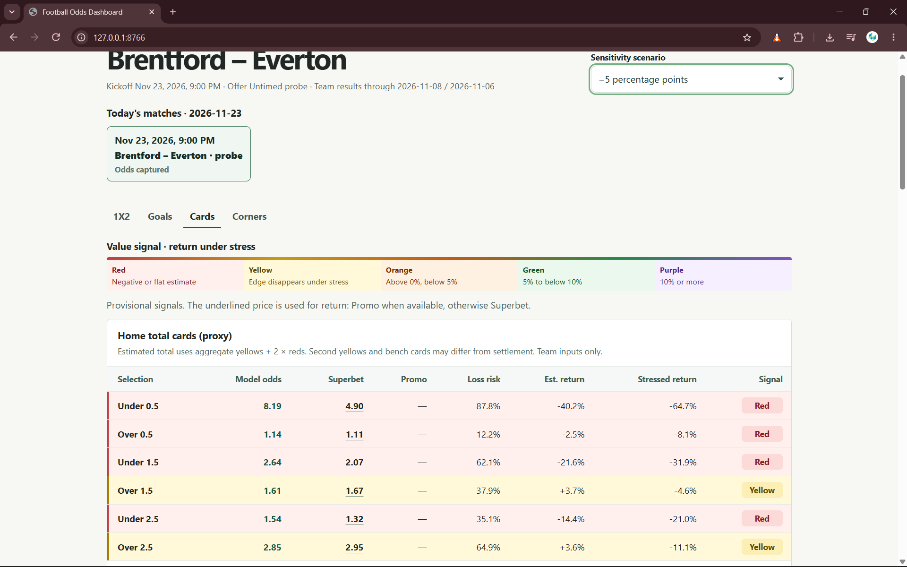

# football-odds-predictor

Football research project using Python 3.12 and uv. The current dashboard compares sporting-model estimates with pre-match Superbet Romania offers. A separate research track predicts Bet365 closing 1X2 odds.

## What works today

| Stage | What it does |
| --- | --- |
| Historical match data | Normalizes five seasons from three leagues and builds pre-match Elo and five-match histories. |
| Bet365 closing-odds experiment | Compares median, Ridge, XGBoost, and LSTM. Includes a final-season test, a replay on recent fixtures, and result plots. |
| Sporting probabilities | Compares statistical baselines, linear models, and XGBoost across 1X2, goals, yellow cards, corners, and player total shots. These models learn from sporting outcomes, not bookmaker odds. |
| Superbet collection | Watches Premier League, Bundesliga, La Liga, Champions League, and Europa League fixtures. It attempts one capture around 15 minutes before kickoff and saves the raw offer and supported single-selection promotions. |
| Offer calculator | Takes supplied probabilities, price, stake, and budget. Shows value, loss probability, and a provisional color. |
| Match dashboard | Automatically lists today's upcoming fixtures and saved captures. Compare model odds with Superbet prices for 1X2, goals, cards, and corners. |
| Virtual portfolio evaluator | Replays a CSV of simulated selections and reports profit, return, open stakes, and drawdown. |

The [Bet365 experiment notes](docs/project-plan.md) describe the first research track and its results. The [Superbet assessment plan](docs/superbet-assessment.md) explains the current track, its data sources, worked examples, and results.



## Getting started

Use the [contributor guide](CONTRIBUTING.md) for the one-time data setup. The clone includes `data/processed/matches.csv` and `data/processed/features.csv` for the Bet365 experiment. Raw archives, Superbet snapshots, and fitted model files stay local and must be downloaded or generated separately.

## Full daily workflow

Fit the models once after downloading the inputs. Repeat these commands only when the data or model settings change. See the contributor guide for the required files for each model:

```bash
uv run python -m football_odds_predictor.training.fit_sporting
uv run python -m football_odds_predictor.training.fit_cards
uv run python -m football_odds_predictor.training.fit_corners
uv run python -m football_odds_predictor.training.fit_europe_corners
uv run python -m football_odds_predictor.training.fit_ucl
```

Then keep these two commands running in separate terminals:

**Terminal 1 — collect Superbet odds**

```bash
uv run python -m football_odds_predictor.data.superbet_watch
```

**Terminal 2 — view the dashboard**

```bash
uv run python -m football_odds_predictor.evaluation.dashboard
```

Open [the dashboard](http://127.0.0.1:8765). It lists today's upcoming fixtures and selects the first one automatically. The dashboard refreshes its fixture list every 30 seconds and the public schedule every two minutes. The watcher refreshes its schedule hourly and attempts one odds capture per fixture, about 15 minutes before kickoff (accepted window: 10–20 minutes). It does not continuously refresh a captured quote. Both terminals must stay open. Stop either process with `Ctrl+C`.

The dashboard shows 1X2, goals, cards, and corners. Player shots remain available in the research and terminal report, but are hidden from the dashboard. The sensitivity options reduce the model's estimated probability by 5 or 10 percentage points to calculate provisional colors; with no sensitivity adjustment, colors are blank.

European team history uses a shared club Elo and recent results from Transfermarkt, Open Matchday, and OpenFootball. The current coverage audit spans 26 domestic leagues to help form estimates for European fixtures; it does not mean that Superbet odds are currently collected for all 26 leagues. See the [European model notes](docs/european-model-plan.md).
